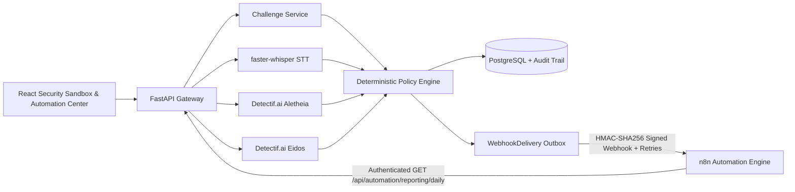

# VoiceSuraksha-Sync — Security Sandbox & n8n Automation Guide

## 1. Architecture Overview



- **FastAPI** remains the sole authority for authentication, voice verification, challenge validation, policy evaluation, authorization tokens, and audit events.
- **n8n** is strictly an external automation engine for alerts, incident summaries, cross-domain notifications, and scheduled reporting. Automation failures never alter FastAPI decisions.

## 2. Sandbox User Journey & Industry Scenarios

1. Navigate to **Security Sandbox** (`/security/sandbox`) in the authenticated console.
2. View real database metrics (total tests, approved, rejected, review-required, recent sessions, latest incidents).
3. Choose one of four industry environments:
   - **Telecom**: `sim_replacement` (SIM Replacement Request)
   - **Banking**: `change_registered_phone` (Sensitive Account Modification)
   - **IT Helpdesk**: `mfa_reset` (MFA Reset Request)
   - **Education**: `view_academic_records` (Restricted Student Record Access)
4. Click **Start Simulation** to create a `VerificationSession` (`source_mode="SANDBOX"`), `SandboxSession`, and fresh single-use `Challenge`.
5. Record or upload audio and submit to run the real backend verification pipeline.

## 3. Attack Simulation Lab

The Attack Simulation Lab supports six real pipeline tests:
- **Genuine Speaker**: Enrolled speaker speaks the fresh challenge phrase.
- **Different Speaker Attack**: Different speaker submits audio; Eidos evaluates speaker match.
- **AI-Generated Voice Attack**: Upload synthetic/cloned voice sample; Aletheia evaluates authenticity.
- **Replay Attack**: Submits audio against an already-consumed challenge ID to verify server-side replay protection.
- **Incorrect Challenge Phrase**: Spoken audio does not match the fresh challenge phrase.
- **Poor Audio Quality**: Short, silent, noisy, corrupted, or unsupported audio files rejected safely.

## 4. Database Schema Changes

Alembic migration `backend/alembic/versions/a1b2c3d4e5f6_sandbox_and_n8n_automation.py` adds:
- `sandbox_sessions`: Tracks sandbox sessions, industry, scenario, attack_type, summaries, audit_event_id, timestamps.
- `webhook_deliveries`: Durable transactional outbox for n8n events (`event_id` unique idempotency key, `status`, `attempt_count`, `max_attempts`, `http_status`, `last_error`).
- `automation_configs`: Persists runtime `enabled` toggle without storing secrets.

## 5. Backend API Endpoints

### Sandbox (`/api/sandbox`)
- `GET /api/sandbox/environments`
- `GET /api/sandbox/overview`
- `GET /api/sandbox/sessions` (search, industry/decision/date filters, pagination)
- `POST /api/sandbox/sessions`
- `GET /api/sandbox/sessions/{sandbox_session_id}`
- `POST /api/sandbox/sessions/{sandbox_session_id}/verify`
- `GET /api/sandbox/analytics`

### Automation (`/api/automation`)
- `GET /api/automation/status`
- `POST /api/automation/toggle`
- `POST /api/automation/test-webhook`
- `GET /api/automation/deliveries`
- `POST /api/automation/deliveries/{delivery_id}/retry`
- `GET /api/automation/reporting/daily` (requires Bearer JWT or `X-VoiceSuraksha-Reporting-Key`)

## 6. Webhook Payload & Security

Events are signed with HMAC-SHA256 (`X-VoiceSuraksha-Signature: sha256=...`) over `<timestamp>.<event_id>.<body>` using `N8N_WEBHOOK_SECRET`. Payloads omit raw audio, API keys, and authorization tokens. See `automation/n8n/example-payloads.json`.

## 7. Environment Variables

Configure in `.env` (never commit real secrets):
```
N8N_ENABLED=false
N8N_BASE_URL=http://localhost:5678
N8N_WEBHOOK_URL=http://localhost:5678/webhook/voicesuraksha-events
N8N_WEBHOOK_SECRET=replace-with-random-hmac-webhook-secret
N8N_TIMEOUT_SECONDS=8
N8N_MAX_RETRIES=3
N8N_REPORTING_API_KEY=replace-with-random-reporting-api-key
```

## 8. Testing Instructions

```bash
cd backend
.venv/bin/pytest -q
```
Frontend build check:
```bash
cd frontend
npm run build
```

## 9. Known Limitations

- n8n workflow activation requires importing the JSON files in `automation/n8n/workflows/` into a running n8n instance.
- Live Aletheia/Eidos inference requires `DETECTIF_API_KEY`; without it, `DETECTIF_PROVIDER_MODE=auto` uses the clearly labelled mock adapter.
- Workflow 3 (Cross-Domain Security Notification) is a notification demonstration only; FastAPI enforces all domain blocking and step-up rules.
